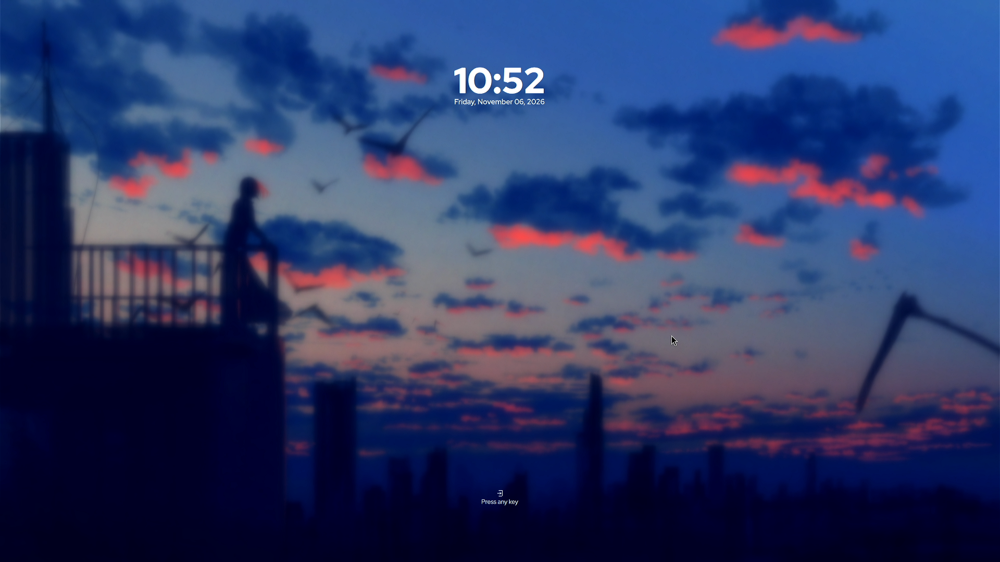
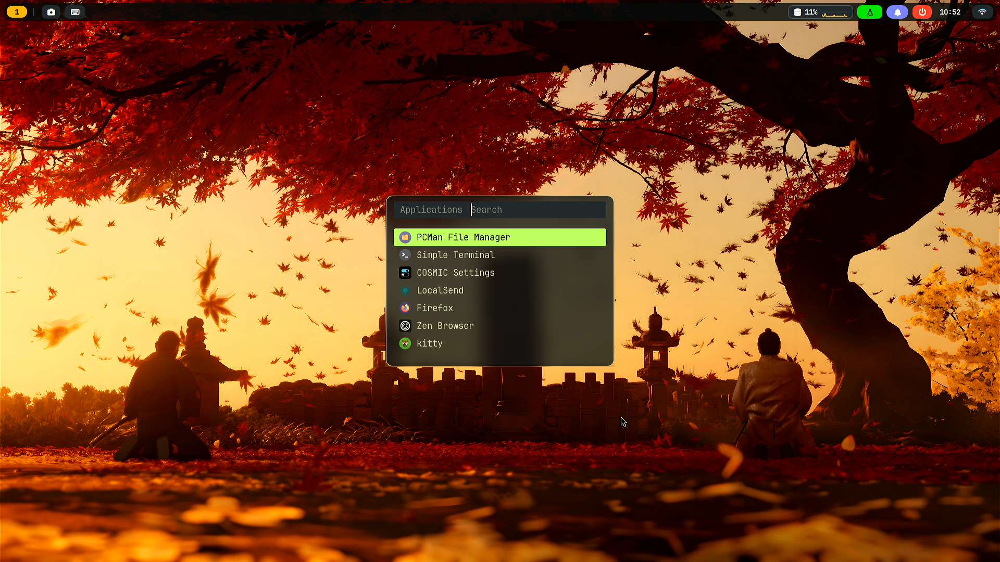
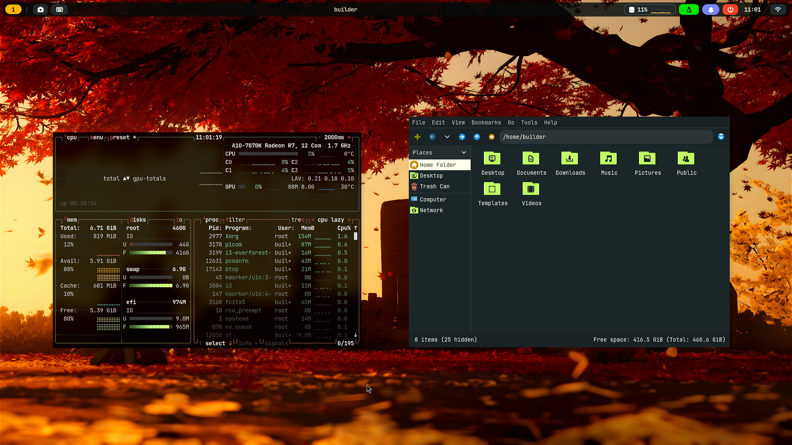

# Maplsyii-Theme One-Click Installer

On a freshly installed **Debian 13 (trixie)**, reproduce the
[\[Sway\] - Everforest](https://plus.diolinux.com.br/t/sway-everforest/63254) desktop
with a single command.

Everything the look depends on ships with the installer: GTK theme, icons, fonts, wallpaper, SDDM theme —
even the sources for the terminal and the status bar are in the package, so after installing you never
have to hunt down assets anywhere.

## Preview

| SilentSDDM · idle clock | SilentSDDM · login |
|---|---|
|  |  |
| **rofi launcher** | **btop and pcmanfm** |
|  |  |

The wallpaper and avatar are sourced from the internet; if this infringes any rights, please contact us for removal!


## System requirements

Debian 13 (amd64/arm64), a regular desktop user (uid ≥ 1000), root via `sudo`.

## Project structure

```
sway-everforest/
├── README.md
├── i3-setup.sh              built by src/build-i3.sh
├── sway-setup.sh            built by src/build-sway.sh
├── assets/                  everything both rices install in common
│   ├── bar-config/          i3 status bar settings (bar.json)
│   ├── bar-i3/              X11 C status bar source
│   ├── bar-sway/            Wayland C status bar source
│   ├── tools/               standalone commands embedded into the installer
│   ├── fonts/  gtk-theme/  icons/  sddm/  st-patches/
│   ├── wallpaper.jpg
│   └── user-avatar.jpg
└── src/
    ├── build-i3.sh          assemble the i3 installer
    ├── build-sway.sh        assemble the sway installer
    ├── i3/                  i3 installer sections, in load order
    └── sway/                sway installer sections, in load order
```

Both rices share `assets/`, but each keeps its own source directory, so they can evolve independently.
Both build scripts are relative to the project root, so they can be run from anywhere; the installers are
generated next to this README, and no build artifacts are kept in the repository.


## Quick start

### Prerequisites

The installer pulls in everything else itself, but the build toolchain and the
development headers used to compile the two C programs (`i3-everforest-bar` and
`st` on X11, `i3-everforest-bar-wl` on Wayland) are worth installing up front.
On a stock Debian 13 image `make`, `cc` and `patch` are not guaranteed to be
present, and `st` needs the Xft/fontconfig headers that the package lists do not
name:

```sh
sudo apt install -y build-essential pkg-config patch \
                    libx11-dev libxft-dev libfontconfig1-dev \
                    libcairo2-dev libpango1.0-dev
```

Skip it and the bar build stops the install (there is no fallback bar), while
`st` only prints a warning and the desktop ends up without a terminal.

Interactive runs first show a three-way action menu:

```
  1  Install      install the components you pick
  2  Reinstall    re-select everything and install again
  3  Uninstall    remove everything this script installed
```

Passing `--yes`, `--uninstall`, or `--dry-run` skips that question entirely.

```sh
chmod +x i3-setup.sh
sudo ./i3-setup.sh
```

You will see a numbered menu; type a number to toggle a component, then press `i` to install:

```
  [x] 1      Desktop core    i3, GTK bar, kitty, rofi, dunst, feh
       Required. X11 window manager, bar, terminal, launcher, notifications.
  [x] 2      Everyday apps   pcmanfm, btop, pavucontrol, flameshot, imv, mpv
  ...
  [x] 8      Shell extras    mf fetch block + Everforest bash prompt

  ────────────────────────────────────────────────────────────────────
  selected: 8/8

  1-8 toggle    a all    n none    i install    q quit
```

Afterwards: **reboot**. SDDM comes up with the SilentSDDM login screen; choose
**i3 (Everforest)** to enter the desktop. From a TTY you can also run `startx i3`.

### Non-interactive

```sh
sudo ./i3-setup.sh --yes                  # all components
sudo ./i3-setup.sh --only-dots --yes      # config files only
sudo ./i3-setup.sh --only-theme --yes     # theme + icons only
```

### Undo

```sh
sudo ./i3-setup.sh --uninstall --keep-packages
```

---

## Choosing the GPU driver: `sway-everforest-fix-grub`

The installer **never touches the kernel command line.** That is deliberate: a wrong driver switch can
leave a machine with no display at all, and that risk should not be shouldered by the installer on the
user's behalf. It supports Intel, NVIDIA, and AMD out of the box and does not interfere with the choice of
`radeon`/`amdgpu`/`i915`.

There is exactly one case that really does need a change. The Wayland login manager runs under weston,
and weston 16 refuses to start without DRM atomic modesetting:

```
Error: Kernel DRM KMS does not support DRM_CLIENT_CAP_ATOMIC.
fatal: failed to create compositor backend
```

SDDM has no fallback, so the screen just sits on a blinking cursor. On AMD CIK hardware (Kaveri and
contemporaries) the default `radeon` driver does not support atomic modes, while `amdgpu` does — provided
Display Core is forced on. A standalone tool performs that switch when you ask for it:

```sh
sudo sway-everforest-fix-grub              # interactive menu
sudo sway-everforest-fix-grub --status     # show current status
sudo sway-everforest-fix-grub --apply      # radeon -> amdgpu (appends dc=1)
sudo sway-everforest-fix-grub --revert     # restore the original command line
sudo sway-everforest-fix-grub --perf on    # pin the GPU to high performance
sudo sway-everforest-fix-grub --perf off   # restore automatic clocks
```

`--status` reports whatever it can detect and is safe to run at any time:

```
GPUs
  AMD      amdgpu       0000:00:01.0   (display)
  NVIDIA   nvidia       0000:01:00.0

DRM atomic modesetting: supported

GPU clocks
  performance level : high
  current clock     : 910 MHz
  clock service     : enabled
```

It detects hardware through `/sys` (PCI class + vendor + bound driver) rather than guessing from names,
and probes atomic modesetting support with the kernel's own `drmSetClientCap` ioctl rather than inferring
it. The first `--apply` backs up `/etc/default/grub` verbatim to `/var/lib/sway-everforest/`, so
`--revert` is always available.

### Why a GPU clock service is needed

`amdgpu` on CIK initializes DPM but never exposes a clock table (`pp_dpm_sclk` is empty), so the governor
cannot select states on demand: under load the GPU jumps to about 520 MHz, then immediately falls back to
the 354 MHz floor. Games run at roughly half speed.

`--perf on` installs `amdgpu-performance.service`, which pins the performance level to `high`
(about 910 MHz) at boot. The cost is real — the GPU no longer downclocks at idle, so it runs at full power
and hotter — which is why it is off by default and reversible.

---

### Rebuilding

```sh
./src/build-i3.sh                           # -> i3-setup.sh
./i3-setup.sh --list         # basic check
bash -n i3-setup.sh          # syntax check
```
---

### The status bar is a native Wayland C program, rather than Waybar

`assets/bar-sway/` is a cairo status bar built on `wl_shm` and `wlr-layer-shell`. It is a direct port of
the X11 status bar (`assets/bar-i3`): the same drawing code, the same module order, the same color palette.

It exists because **Waybar cannot draw a CPU line graph**. The `custom` module can only output text, and
a single character cell cannot hold a 1.6px line — the closest approximations (block glyphs, then braille
dots) are visibly wrong when compared against the i3 screenshot. Drawing with cairo into a shm buffer
reproduces the same 46×20 chart exactly, including the filled area under the line and the 50% reference
line.

Measured on the same machine with the same desktop:

| | Waybar | `i3-everforest-bar-wl` |
|---|---|---|
| PSS | 29 MB | **5.5 MB** |
| CPU | 0.5% | 0.7% |
| Link-time dependencies | 114 | 12 |

The CPU figure is slightly higher because the C status bar redraws the chart at 15Hz while Waybar polls
once per second; what you get in exchange is a curve that actually moves.

### Building the status bar

The installer compiles it on the target machine, so it links against that machine's libwayland/cairo/pango:

```bash
sudo apt install wayland-protocols libwayland-dev libxkbcommon-dev \
                 libcairo2-dev libpango1.0-dev
cd assets/bar-sway && make
```

**There is no Waybar fallback**: if the build fails, the installer stops. The status bar is not optional,
and silently swapping in another one would only hide the failure behind a UI that looks almost right.

---

## Status bar transparency

`--opacity soft|clear|solid` writes to `~/.config/i3-everforest/bar.conf`:

```ini
# opacity: solid | soft | clear
opacity=soft
```

The status bar reads that file at startup, with the following precedence:

1. `$BAR_WL_OPACITY` — one-run override, handy for testing
2. `~/.config/i3-everforest/bar.conf` — what the installer wrote
3. `solid` — the default

The presets are `solid` (1.00), `soft` (0.82), and `clear` (0.35).

---

Changing it at runtime:

```sh
i3-everforest-bar-opacity            # cycle solid -> soft -> clear
i3-everforest-bar-opacity clear      # set a specific preset
```

The helper rewrites `bar.json` and sends `SIGHUP`; the status bar re-reads the file and redraws, so no
restart is needed and the choice survives the next login. Reinstalls no longer reset it: `--opacity` is
applied only when passed explicitly.

## Status bar dependencies

Every capsule on the status bar invokes some program, and a missing program means a click that silently
does nothing. The installer therefore audits them:

| Capsule | Invokes | Packages |
|---|---|---|
| Workspaces / windows | i3 itself (`i3-msg`) | `i3-wm` |
| Color picker | `i3-everforest-pick` → slop, maim, imagemagick, xclip | `slop`, `maim`, `imagemagick`, `xclip` |
| Screenshot | `i3-everforest-shot` → maim/slurp, xclip | `maim`, `slop`, `xclip` |
| Input method | `i3-everforest-ime` → fcitx5 / ibus, otherwise `setxkbmap` | optional (`fcitx5`/`ibus`) |
| Notifications | `i3-everforest-notifications` → dunstctl, notify-send | `dunst`, `libnotify-bin` |
| Launcher | `rofi -show drun` | `rofi` |
| Power | `i3-everforest-powermenu` → rofi + systemctl | `rofi` |
| Disk/CPU | `i3-everforest-sysinfo`, monitor → btop | `btop` |
| Clock | `i3-everforest-calendar` → cal | `bsdmainutils` |
| Network | `i3-everforest-wifi` → nmcli, rofi | `network-manager`, `rofi`; right-click uses `nm-connection-editor` (`network-manager-gnome`) |

The rofi/pavucontrol/nm-connection-editor group is installed by a dedicated **bar actions** group that
runs together with the dotfiles component, so the buttons keep working even with `--no-apps`.

---

## What gets installed

**Packages** — `i3-wm i3status i3lock xinit xserver-xorg x11-xserver-utils
x11-utils xserver-xorg-video-all xserver-xorg-input-libinput xauth dbus-x11
xcape numlockx xinput x11-xkb-utils python3-gi gir1.2-gtk-3.0
python3-xlib python3-i3ipc kitty rofi dunst feh xwallpaper picom dbus
libpam-systemd polkitd lxpolkit brightnessctl playerctl network-manager
pipewire wireplumber pulseaudio-utils fonts-jetbrains-mono fonts-font-awesome
fonts-noto-color-emoji gtk2-engines-murrine gnome-themes-extra librsvg2-common`
plus the optional `pcmanfm gvfs btop fastfetch pavucontrol network-manager-gnome
imv mpv flameshot swappy cliphist imagemagick`.

The screenshot and color-picking tools (`maim`, `slop`, `xclip`, `xdotool`,
`xprintidle`, `xss-lock`) belong to **bar actions**, not to the optional apps: they are installed
together with the dotfiles component, so the status bar buttons keep working even with `--no-apps`.

**Configuration**

```
~/.config/i3/config                window manager + keybindings
~/.config/i3-everforest/bar.json   status bar layout (mirrors the Waybar config)
/usr/local/bin/i3-everforest-bar    status bar program
~/.config/rofi/{config.rasi,i3-everforest.rasi}
~/.config/kitty/kitty.toml
~/.config/dunst/dunstrc
~/.config/picom/picom.conf
~/.config/i3/i3lock-color.xresources
~/.config/btop/themes/everforest.theme
~/.config/gtk-3.0/settings.ini
~/.config/gtk-4.0/{settings.ini,gtk.css,gtk-dark.css,assets}   (libadwaita)
~/.gtkrc-2.0
~/.xsessionrc                      X11 session environment
~/.Xresources                      Xft / cursor settings
~/.local/share/i3-everforest/wallpaper.jpg
/usr/share/themes/Everforest-Dark-BL-LB
/usr/share/icons/Material-Black-Lime-Numix-FLAT
/usr/share/xsessions/i3-everforest.desktop
/usr/local/bin/i3-everforest-session   session launcher used by the entry
/usr/local/bin/st                   terminal (built from source at install time)
/usr/local/src/i3-everforest-st     st source tree + applied patches
/usr/local/share/applications/st.desktop   lets launchers list that terminal
/usr/local/bin/mf                   two-column fetch block
/usr/share/sddm/themes/silent      SilentSDDM (stock configs/default.conf)
/etc/sddm.conf.d/10-i3-everforest.conf
/usr/share/fonts/silent-sddm       RedHatDisplay, used by the login screen
```

### Keybindings

| Key | Action |
|---|---|
| `Mod+Return` | Terminal (st) |
| `Mod+D` | Application launcher (rofi) |
| `Mod+E` | Files (pcmanfm) |
| `Mod+Shift+Return` | btop |
| `Mod+Shift+E` | Power menu (rofi) |
| `Mod+1..8` | Workspaces |
| `Mod+Shift+C` | Reload i3 |
| `Mod+Shift+R` | Restart i3 |
| `Mod+Escape` | Lock screen (i3lock) |
| `Print` / `Mod+Print` | Full screen / region screenshot |
| `Mod+Shift+Print` | flameshot region screenshot |
| `Mod+F`, `Mod+W`, `Mod+R`, `Mod+Shift+Space` | Fullscreen, tabbed, resize mode, floating |
| `Mod+H/J/K/L` | Focus left/down/up/right |

`Print` copies the whole screen to the clipboard, `Mod+Print` copies a dragged region, and
`Mod+Shift+Print` opens that region in swappy — the same three bindings as the sway version. Caps Lock
acts as Ctrl, and the touchpad supports tap-to-click, natural scrolling, and disable-while-typing,
exactly matching sway's `input` block (applied at session start by `i3-everforest-input`).

`Mod` is the Super/Windows key. `Caps Lock` is mapped to `Ctrl` through the keyboard configuration.