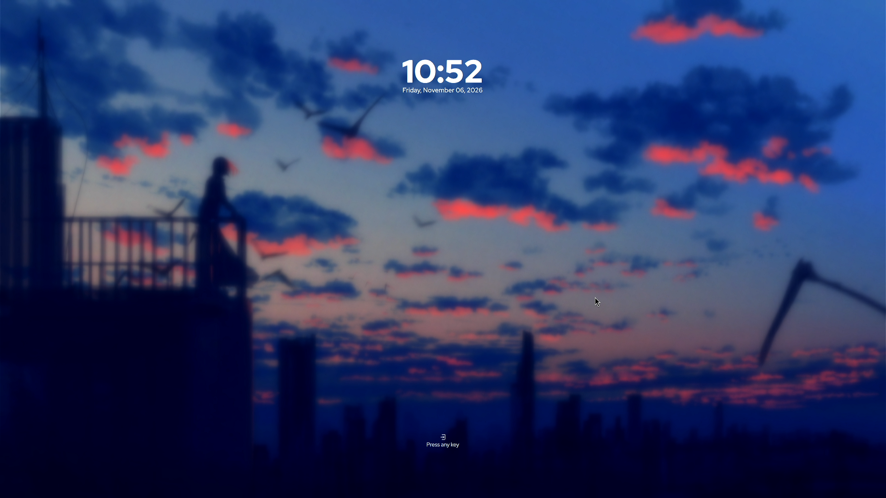
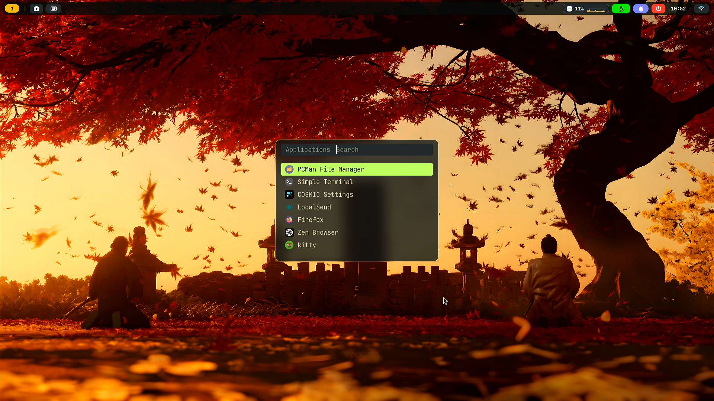
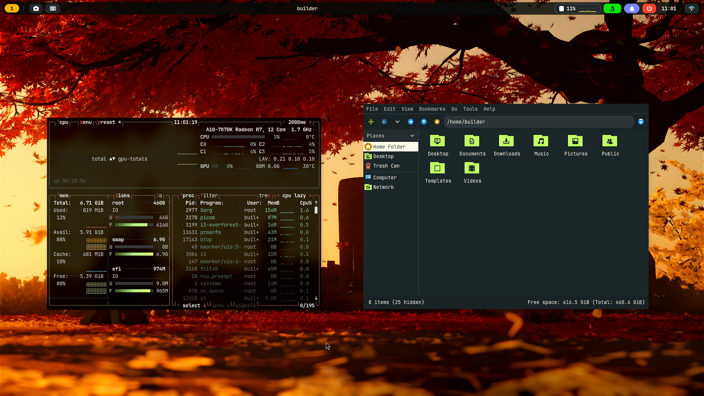

# Maplsyii-Theme 一键安装器

在全新安装的 **Debian 13 (trixie)** 上，用一条命令复刻出
[\[Sway\] - Everforest](https://plus.diolinux.com.br/t/sway-everforest/63254) 那套桌面。

外观所依赖的一切都随安装器走：GTK 主题、图标、字体、壁纸、SDDM 主题，连终端和状态栏的
源码都在包里，装完不必再去任何地方找素材。

## 效果预览

| SilentSDDM · 待机时钟 | SilentSDDM · 登录 |
|---|---|
|  |  |
| **rofi 启动器** | **btop 与 pcmanfm** |
|  |  |

壁纸和头像均来源于网络，如有侵权请联系删除！


## 系统要求

Debian 13（amd64/arm64），一个普通桌面用户（uid ≥ 1000），通过 `sudo` 获取 root。
</content>

## 项目结构

```
sway-everforest/
├── README.md
├── i3-setup.sh              由 src/build-i3.sh 构建
├── sway-setup.sh            由 src/build-sway.sh 构建
├── assets/                  两套 rice 共同安装的全部内容
│   ├── bar-config/          i3 状态栏设置（bar.json）
│   ├── bar-i3/              X11 C 状态栏源码
│   ├── bar-sway/            Wayland C 状态栏源码
│   ├── tools/               嵌入安装器的独立命令
│   ├── fonts/  gtk-theme/  icons/  sddm/  st-patches/
│   ├── wallpaper.jpg
│   └── user-avatar.jpg
└── src/
    ├── build-i3.sh          组装 i3 安装器
    ├── build-sway.sh        组装 sway 安装器
    ├── i3/                  i3 安装器各段，按加载顺序
    └── sway/                sway 安装器各段，按加载顺序
```

两套 rice 共享 `assets/`，但各自保留独立的源码目录，因此可以互不干扰地演进。两个构建脚本都以项目根目录为基准，因此可在任意位置运行；安装器生成在本 README 旁边，且仓库中不保留任何构建产物。


## 快速开始

交互式运行会先显示三选一操作菜单：

```
  1  Install      install the components you pick
  2  Reinstall    re-select everything and install again
  3  Uninstall    remove everything this script installed
```

传入 `--yes`、`--uninstall` 或 `--dry-run` 可完全跳过该问题。

```sh
chmod +x i3-setup.sh
sudo ./i3-setup.sh
```

你会看到一个编号菜单；输入数字切换组件，然后按 `i` 安装：

```
  [x] 1      Desktop core    i3, GTK bar, kitty, rofi, dunst, feh
       Required. X11 window manager, bar, terminal, launcher, notifications.
  [x] 2      Everyday apps   pcmanfm, btop, pavucontrol, flameshot, imv, mpv
  ...
  [x] 8      Shell extras    mf fetch block + Everforest bash prompt

  ────────────────────────────────────────────────────────────────────
  selected: 8/8

  1-8 toggle    a all    n none    i install    q quit
```

之后：**重启**。SDDM 会带着 SilentSDDM 登录界面启动；选择
**i3 (Everforest)** 即可进入桌面。在 TTY 中也可以运行 `startx i3`。

### 非交互式

```sh
sudo ./i3-setup.sh --yes                  # 全部组件
sudo ./i3-setup.sh --only-dots --yes      # 仅配置文件
sudo ./i3-setup.sh --only-theme --yes     # 仅主题 + 图标
```

### 撤销

```sh
sudo ./i3-setup.sh --uninstall --keep-packages
```

---

## GPU 驱动选择：`sway-everforest-fix-grub`

安装器**从不改动内核命令行。** 这是刻意的：错误的驱动切换会让机器彻底没有显示，这个风险不该由安装器替用户承担。它开箱支持 Intel、NVIDIA 和 AMD，并不干预 `radeon`/`amdgpu`/`i915` 的选择。

只有一种情况确实需要改动。Wayland 登录管理器运行在 weston 下，而 weston 16 在没有 DRM 原子模式设置时拒绝启动：

```
Error: Kernel DRM KMS does not support DRM_CLIENT_CAP_ATOMIC.
fatal: failed to create compositor backend
```

SDDM 没有回退机制，因此屏幕会停在闪烁的光标上。在 AMD CIK 硬件（Kaveri 及同代）上，默认的 `radeon` 驱动不支持原子模式，而 `amdgpu` 支持——但前提是强制开启 Display Core。一个独立工具会在你要求时执行这次切换：

```sh
sudo sway-everforest-fix-grub              # 交互式菜单
sudo sway-everforest-fix-grub --status     # 显示当前状态
sudo sway-everforest-fix-grub --apply      # radeon -> amdgpu（追加 dc=1）
sudo sway-everforest-fix-grub --revert     # 恢复原始命令行
sudo sway-everforest-fix-grub --perf on    # 将 GPU 固定为高性能模式
sudo sway-everforest-fix-grub --perf off   # 恢复自动频率
```

`--status` 会报告它能检测到的信息，任何时间运行都安全：

```
GPUs
  AMD      amdgpu       0000:00:01.0   (display)
  NVIDIA   nvidia       0000:01:00.0

DRM atomic modesetting: supported

GPU clocks
  performance level : high
  current clock     : 910 MHz
  clock service     : enabled
```

它通过 `/sys`（PCI class + vendor + 已绑定驱动）检测硬件，而不是靠名字猜测；并用内核自身的 `drmSetClientCap` ioctl 探测原子模式支持，而非推断。第一次 `--apply` 会把 `/etc/default/grub` 原样备份到 `/var/lib/sway-everforest/`，因此 `--revert` 始终可用。

### 为什么需要 GPU 频率服务

CIK 上的 `amdgpu` 会初始化 DPM，却从不导出频率表（`pp_dpm_sclk` 为空），因此调速器无法按需选择状态：GPU 在负载下瞬间跳到约 520 MHz，随即跌回 354 MHz 的下限。游戏只能以大约一半速度运行。

`--perf on` 会安装 `amdgpu-performance.service`，在启动时把性能级别固定为 `high`（约 910 MHz）。代价是真实的——GPU 不再降频待机，因此满功耗运行、发热更高——所以它默认关闭且可撤销。

---

### 重新构建

```sh
./src/build-i3.sh                           # -> i3-setup.sh
./i3-setup.sh --list         # 基本检查
bash -n i3-setup.sh          # 语法检查
```
---

### 状态栏是原生 Wayland C 程序，而非 Waybar

`assets/bar-sway/` 是一个基于 `wl_shm` 和 `wlr-layer-shell` 的 cairo 状态栏。它是 X11 状态栏（`assets/bar-i3`）的直接移植：相同的绘制代码、相同的模块顺序、相同的配色。

它存在的原因是 **Waybar 无法绘制 CPU 折线图**。`custom` 模块只能输出文本，而一个字符单元格容纳不下 1.6px 的折线——最接近的近似方案（块状字形、再到盲文点阵）与 i3 截图对比都明显不对。用 cairo 绘制到 shm 缓冲区可以精确还原同样的 46×20 图表，包括线条下方的填充区域和 50% 参考线。

在同一台机器、同一桌面下实测：

| | Waybar | `i3-everforest-bar-wl` |
|---|---|---|
| PSS | 29 MB | **5.5 MB** |
| CPU | 0.5% | 0.7% |
| 链接期依赖 | 114 | 12 |

CPU 数值略高，是因为 C 状态栏以 15Hz 重绘图表，而 Waybar 每秒轮询一次；换来的是真正会动的曲线。

### 构建状态栏

安装器会在目标机器上编译它，因此它链接的是该机器的 libwayland/cairo/pango：

```bash
sudo apt install wayland-protocols libwayland-dev libxkbcommon-dev \
                 libcairo2-dev libpango1.0-dev
cd assets/bar-sway && make
```

**没有 Waybar 回退方案**：构建失败则安装器停止。状态栏不是可选项，悄悄换用另一个只会把一个看起来几乎正确的 UI 掩盖住失败。

---

## 状态栏透明度

`--opacity soft|clear|solid` 会写入 `~/.config/i3-everforest/bar.conf`：

```ini
# opacity: solid | soft | clear
opacity=soft
```

状态栏启动时读取该文件，优先级顺序如下：

1. `$BAR_WL_OPACITY` —— 单次运行覆盖，便于测试
2. `~/.config/i3-everforest/bar.conf` —— 安装器写入的内容
3. `solid` —— 默认值

预设为 `solid`（1.00）、`soft`（0.82）和 `clear`（0.35）。

---

运行时修改：

```sh
i3-everforest-bar-opacity            # 循环 solid -> soft -> clear
i3-everforest-bar-opacity clear      # 设置指定预设
```

该辅助脚本会重写 `bar.json` 并发送 `SIGHUP`；状态栏重新读取文件并重绘，因此无需重启，且该选择在下次登录后依然有效。重装不再重置它：`--opacity` 仅在显式传入时才会应用。

## 状态栏依赖

状态栏上的每个胶囊都会调用某个程序，缺少程序就意味着点击后静默无反应。因此安装器会对它们做审计：

| 胶囊 | 调用 | 软件包 |
|---|---|---|
| 工作区 / 窗口 | i3 自身（`i3-msg`） | `i3-wm` |
| 取色器 | `i3-everforest-pick` → slop、maim、imagemagick、xclip | `slop`、`maim`、`imagemagick`、`xclip` |
| 截图 | `i3-everforest-shot` → maim/slurp、xclip | `maim`、`slop`、`xclip` |
| 输入法 | `i3-everforest-ime` → fcitx5 / ibus，否则 `setxkbmap` | 可选（`fcitx5`/`ibus`） |
| 通知 | `i3-everforest-notifications` → dunstctl、notify-send | `dunst`、`libnotify-bin` |
| 启动器 | `rofi -show drun` | `rofi` |
| 电源 | `i3-everforest-powermenu` → rofi + systemctl | `rofi` |
| 磁盘/CPU | `i3-everforest-sysinfo`、monitor → btop | `btop` |
| 时钟 | `i3-everforest-calendar` → cal | `bsdmainutils` |
| 网络 | `i3-everforest-wifi` → nmcli、rofi | `network-manager`、`rofi`；右键使用 `nm-connection-editor`（`network-manager-gnome`） |

rofi/pavucontrol/nm-connection-editor 这一组由专门的 **bar actions** 组安装，它随 dotfiles 组件一起运行，因此即使使用 `--no-apps`，按钮也仍能工作。

---

## 安装内容

**软件包** —— `i3-wm i3status i3lock xinit xserver-xorg x11-xserver-utils
x11-utils xserver-xorg-video-all xserver-xorg-input-libinput xauth dbus-x11
xcape numlockx xinput x11-xkb-utils python3-gi gir1.2-gtk-3.0
python3-xlib python3-i3ipc kitty rofi dunst feh xwallpaper picom dbus
libpam-systemd polkitd lxpolkit brightnessctl playerctl network-manager
pipewire wireplumber pulseaudio-utils fonts-jetbrains-mono fonts-font-awesome
fonts-noto-color-emoji gtk2-engines-murrine gnome-themes-extra librsvg2-common`
外加可选的 `pcmanfm gvfs btop fastfetch pavucontrol network-manager-gnome
imv mpv flameshot swappy cliphist imagemagick`。

截图与取色工具（`maim`、`slop`、`xclip`、`xdotool`、
`xprintidle`、`xss-lock`）属于 **bar actions**，而非可选应用：它们随 dotfiles 组件一起安装，因此即使使用 `--no-apps`，状态栏按钮也能继续工作。

**配置**

```
~/.config/i3/config                窗口管理器 + 快捷键
~/.config/i3-everforest/bar.json   状态栏布局（镜像 Waybar 配置）
/usr/local/bin/i3-everforest-bar    状态栏程序
~/.config/rofi/{config.rasi,i3-everforest.rasi}
~/.config/kitty/kitty.toml
~/.config/dunst/dunstrc
~/.config/picom/picom.conf
~/.config/i3/i3lock-color.xresources
~/.config/btop/themes/everforest.theme
~/.config/gtk-3.0/settings.ini
~/.config/gtk-4.0/{settings.ini,gtk.css,gtk-dark.css,assets}   （libadwaita）
~/.gtkrc-2.0
~/.xsessionrc                      X11 会话环境
~/.Xresources                      Xft / 光标设置
~/.local/share/i3-everforest/wallpaper.jpg
/usr/share/themes/Everforest-Dark-BL-LB
/usr/share/icons/Material-Black-Lime-Numix-FLAT
/usr/share/xsessions/i3-everforest.desktop
/usr/local/bin/i3-everforest-session   入口使用的会话启动器
/usr/local/bin/st                   终端（安装时从源码构建）
/usr/local/src/i3-everforest-st     st 源码树 + 已应用的补丁
/usr/local/share/applications/st.desktop   使启动器能列出该终端
/usr/local/bin/mf                  双栏 fetch 区块
/usr/share/sddm/themes/silent      SilentSDDM（原厂 configs/default.conf）
/etc/sddm.conf.d/10-i3-everforest.conf
/usr/share/fonts/silent-sddm       RedHatDisplay，供登录界面使用
```

### 快捷键

| 按键 | 动作 |
|---|---|
| `Mod+Return` | 终端（st） |
| `Mod+D` | 应用启动器（rofi） |
| `Mod+E` | 文件（pcmanfm） |
| `Mod+Shift+Return` | btop |
| `Mod+Shift+E` | 电源菜单（rofi） |
| `Mod+1..8` | 工作区 |
| `Mod+Shift+C` | 重载 i3 |
| `Mod+Shift+R` | 重启 i3 |
| `Mod+Escape` | 锁屏（i3lock） |
| `Print` / `Mod+Print` | 全屏 / 区域截图 |
| `Mod+Shift+Print` | flameshot 区域截图 |
| `Mod+F`, `Mod+W`, `Mod+R`, `Mod+Shift+Space` | 全屏、标签页、调整模式、浮动 |
| `Mod+H/J/K/L` | 聚焦 左/下/上/右 |

`Print` 把整个屏幕复制到剪贴板，`Mod+Print` 复制拖选区域，`Mod+Shift+Print` 在 swappy 中打开该区域——与 sway 版本相同的三个绑定。Caps Lock 作为 Ctrl，触摸板支持点击轻触、自然滚动和打字时禁用，与 sway 的 `input` 区块完全一致（由 `i3-everforest-input` 在会话启动时应用）。

`Mod` 是 Super/Windows 键。`Caps Lock` 通过键盘配置映射为 `Ctrl`。